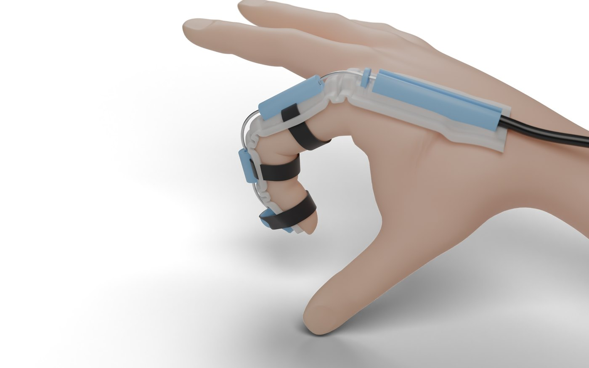
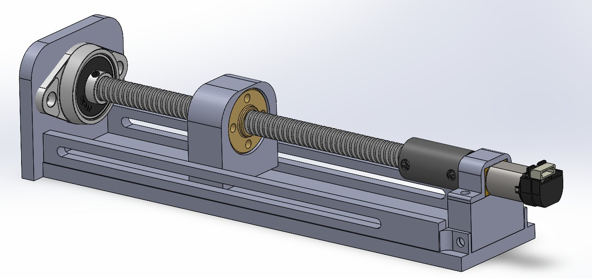
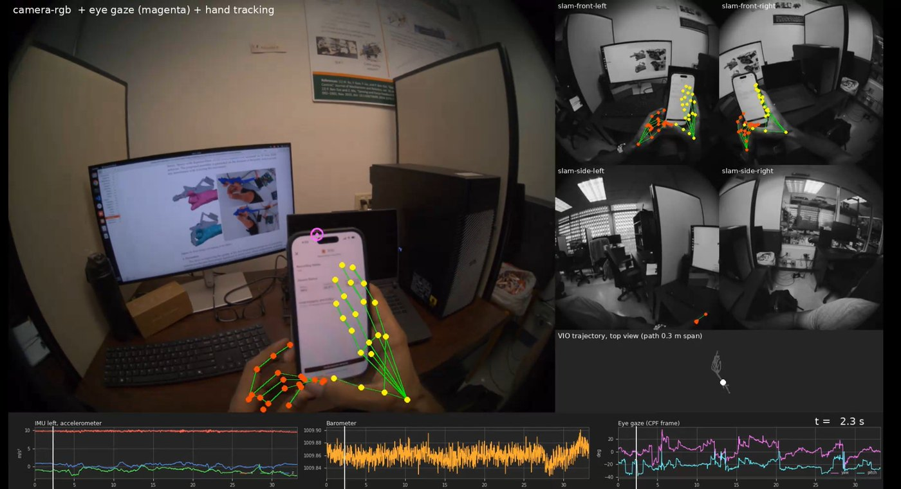

**Robotics and Mechatronics Laboratory, University of Miami** · Graduate Researcher · August 2026–present

<figure>
  
  <figcaption>Concept render of a cable-driven finger module.</figcaption>
</figure>

I lead the design and manufacturing of an assistive hand exoskeleton for patients with brachial plexus injury (BPI), which damages the nerves running from the spinal cord down to the hand. The device drives finger flexion and extension from the back of the hand and uses force sensing to hold objects securely.

Many hand exoskeleton designs have been published, but they are rarely compared under the same conditions. We compare existing designs side by side, first in simulation and then with physical prototypes, and use the results to choose the best approach for our own device.

## What I am working on

* **Simulation test bed:** a common simulation that models cable-driven and rigid-linkage designs on the same standard finger, so their joint range of motion, mechanical advantage and force transmission can be compared directly.
* **Physical prototypes:** finger prototypes of the best-performing designs for bench testing, including a lead-screw linear actuator with Arduino control for the cable-driven design.
* **Test setup:** a phantom finger and motion tracking markers for repeatable measurements, with metrics informed by clinicians and patients.
* **Intent prediction:** a gaze-based interface that identifies the object the user is looking at and the grasp it requires. I am exploring a CNN-based detector for object identification and a recurrent or transformer model for grasp prediction.

<figure>
  
  <figcaption>CAD model of a linear actuator module.</figcaption>
</figure>

<figure>
  
  <figcaption>Recording for the intent prediction interface: head-worn camera video with eye gaze (magenta) and hand tracking overlaid.</figcaption>
</figure>

**Outputs:** poster at the [University of Miami College of Engineering Research Symposium](/talks/2026-10-01-um-coe-exoskeleton-benchmark) (October 2026).

*This work is ongoing and not published yet, so this page is an overview. Some design details and results are left out, and I am happy to discuss them.*
