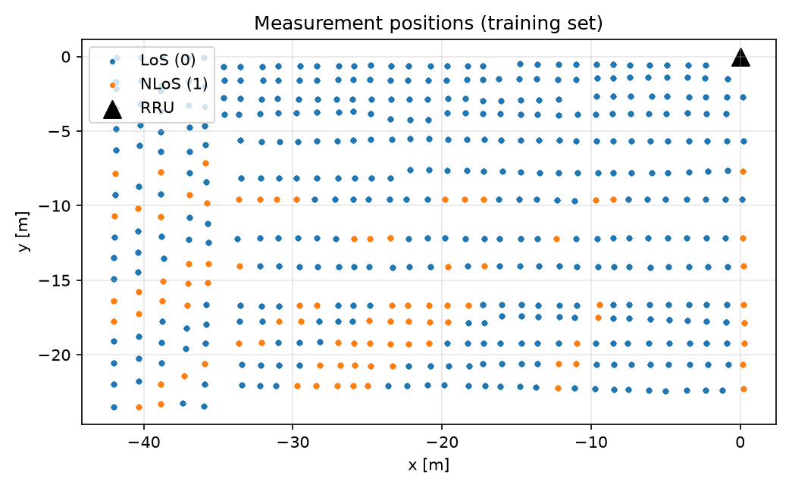
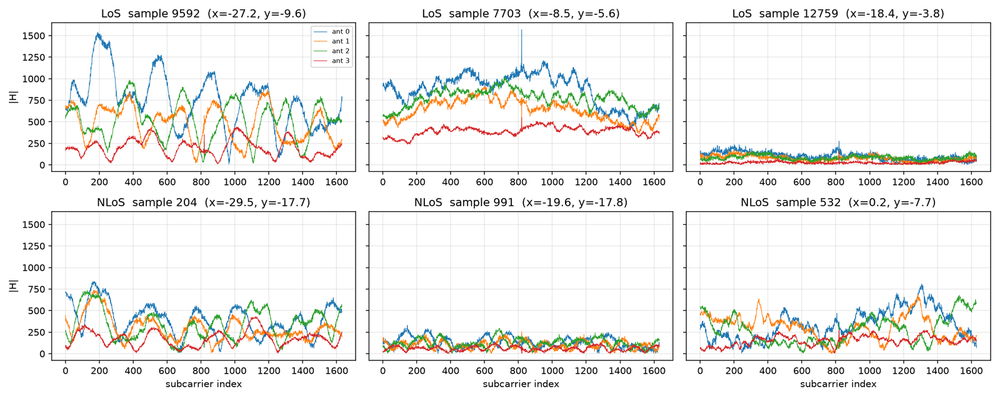
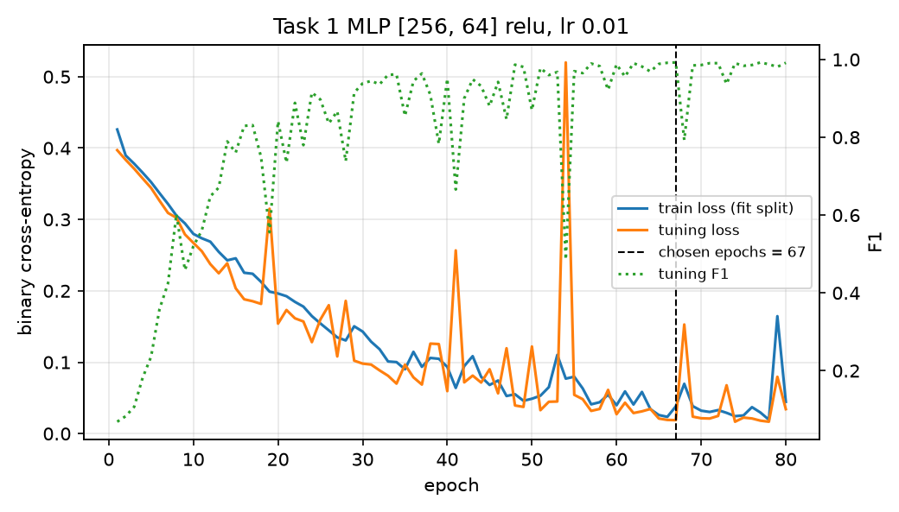
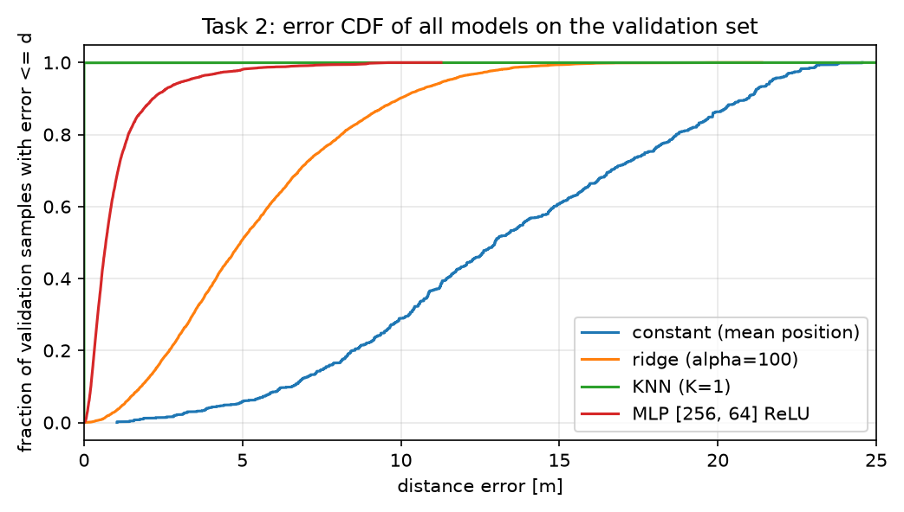
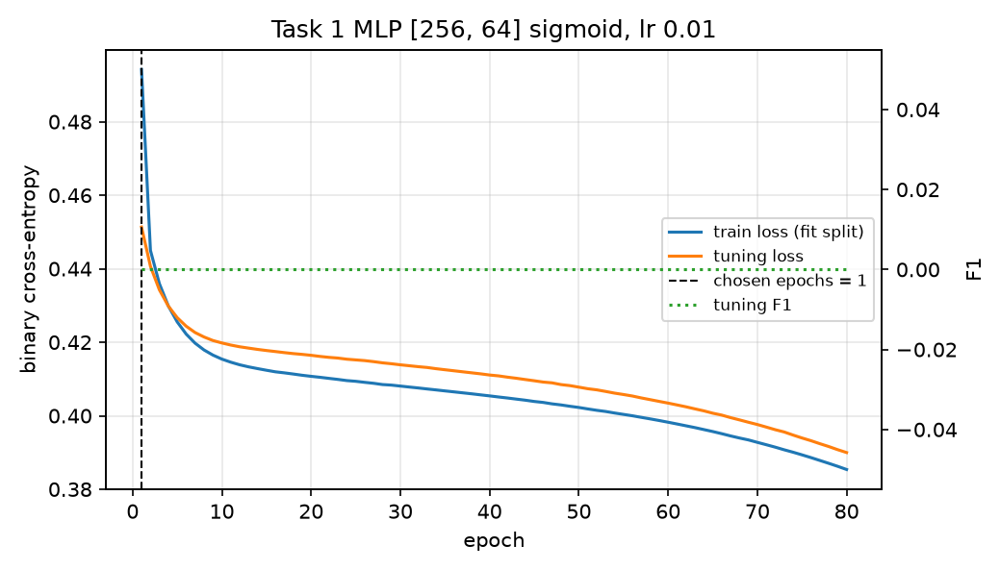

**ECE 653: Neural Networks** · University of Miami · Prof. Mingzhe Chen 
Individual project

<figure>
  
  <figcaption>The 476 measurement positions in the parking lot. The radio unit sits at the origin. Orange positions have no line of sight to it.</figcaption>
</figure>

## Overview

GPS does not work underground, but a vehicle's wireless signal still carries information about where it is. Walls, pillars and other cars reflect the signal, so the channel measured at the receiver changes from one parking spot to the next. This project asks how well a model can read that pattern.

The dataset has 20,000 channel state information (CSI) measurements of a vehicle placed at 476 positions in an underground parking lot of roughly 42 m by 23 m. Each measurement is a complex matrix of 4 antennas by 1,632 subcarriers. I built and compared classical machine learning models and neural networks for two tasks:

1. **Classification:** decide whether the vehicle has line of sight (LoS) to the radio unit or not (NLoS).
2. **Positioning:** estimate the vehicle's (x, y) position in meters.

## What I did

* **Preprocessing:** compared three ways of turning the complex channel matrix into model inputs: the magnitude of each entry (6,528 values), stacked real and imaginary parts (13,056 values), and a delay profile from an inverse FFT across the subcarriers (512 values). Inputs were standardized with statistics from the training data only.
* **Classical models:** logistic regression and K-nearest neighbors (KNN) for classification, ridge regression and KNN regression for positioning, plus a simple baseline for each task.
* **Neural networks:** a multilayer perceptron (MLP) written in PyTorch with two hidden layers of 256 and 64 ReLU units, trained with plain mini-batch SGD. The classifier ends in one sigmoid unit with binary cross-entropy loss. The position model ends in two linear units with mean squared error loss.
* **Evaluation:** tuned every hyperparameter on a split held out from the 15,000 training samples, then scored each model once on the 5,000 test samples. About 82% of the samples are LoS, so I judged the classifiers by F1 score on the NLoS class instead of accuracy.

<figure>
  
  <figcaption>Channel magnitude across the 1,632 subcarriers for six samples, one line per antenna. Top row is LoS, bottom row is NLoS.</figcaption>
</figure>

## Results

### Line-of-sight classification

| Model | Accuracy | F1 (NLoS) | Training time | Model size |
|:--|:--|:--|:--|:--|
| Received-power threshold (baseline) | 0.654 | 0.411 | 2.7 s | 8 B |
| Logistic regression | 0.987 | 0.965 | 15 s | 26 kB |
| MLP, 256 and 64 ReLU units | 0.997 | 0.992 | 41 s | 6.8 MB |
| KNN, K = 1 | 1.000 | 1.000 | none | 392 MB |

<figure>
  
  <figcaption>Training the classification network. The dashed line marks the epoch with the best F1 on the tuning split, which is the checkpoint I kept.</figcaption>
</figure>

### Position estimation

| Model | Mean error | Median error | 90% of samples within | R² |
|:--|:--|:--|:--|:--|
| Always predict the mean position (baseline) | 13.36 m | 12.97 m | 20.94 m | 0.00 |
| Ridge regression | 5.49 m | 4.94 m | 9.97 m | 0.806 |
| MLP, 256 and 64 ReLU units | 1.05 m | 0.69 m | 2.18 m | 0.988 |
| MLP, 512 and 128 ReLU units | 0.94 m | 0.60 m | 1.92 m | 0.990 |
| KNN regression, K = 1 | 0.02 m | 0.00 m | 0.00 m | 0.998 |

<figure>
  
  <figcaption>Share of test samples located within a given distance. The network puts 90% of samples within 2.2 m. Ridge regression needs about 10 m to do the same.</figcaption>
</figure>

## What I learned

* **Positioning needs a nonlinear model.** The network cut the mean error from 5.5 m with ridge regression to about 1 m. For classification the gap was much smaller: logistic regression already reached an F1 of 0.965 with a model 260 times smaller than the network.
* **KNN's perfect score is memorization.** Every test position also appears in the training data, so the nearest stored sample is almost always the same parking spot. KNN would not locate a vehicle at a position it has never seen, and it has to store all 15,000 training samples (392 MB) to work at all.
* **Capacity matters for regression, not for classification.** A single hidden layer of 64 units classified as well as the larger networks (F1 0.993), but its position error was 2.7 m compared with 0.94 m for the largest network.
* **The magnitude was the best input.** The delay profile made the models about 12 times smaller, but the network's position error rose from 1.05 m to 3.55 m. Real and imaginary parts doubled the input size and also did worse (3.01 m).
* **Sigmoid hidden units stalled.** With sigmoid activations in place of ReLU, the same network predicted LoS for every sample for all 80 epochs, a vanishing-gradient failure. Tanh matched ReLU.

<figure>
  
  <figcaption>The same network with sigmoid hidden units. The loss barely moves and the F1 score stays at zero.</figcaption>
</figure>

## Limitations and next steps

The train and test sets share the same 476 positions, so these results show how well the models tell known positions apart, not how well they locate a vehicle somewhere new. The fairer test is to hold out whole positions and measure the error there. I would also try a convolutional network that treats the channel matrix as a 4 by 1,632 image, and optimizers beyond plain SGD.

**Tools:** Python, PyTorch, scikit-learn, NumPy, Matplotlib
